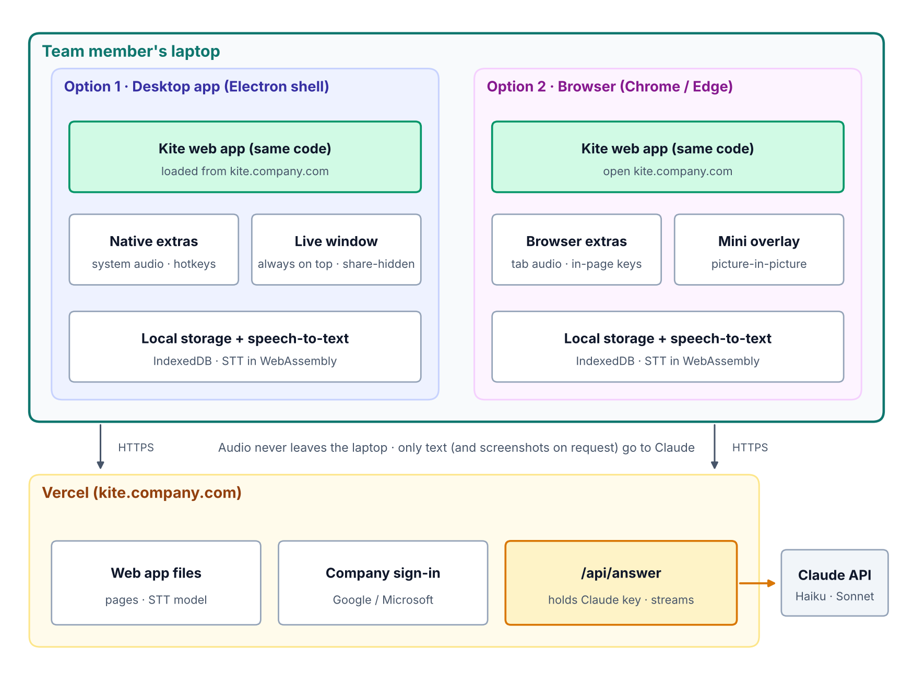
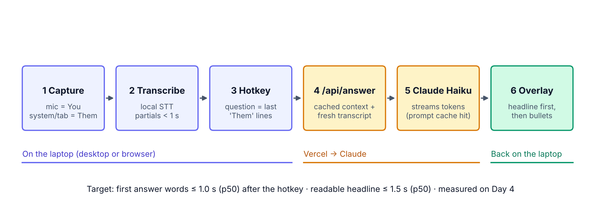

# Kite: Architecture and 7-Day Build Plan v3.2.0

## Document control

| Field | Value |
|---|---|
| Version | 3.2.0, **Current**: the only document to build from |
| Date | 28 October 2026 |
| Changes in 3.2.0 | Day 2 (audio and transcript), matching what was built and measured. §6.1: speech-to-text is streaming-only (Zipformer 2023-06-21 + hotwords, energy gate instead of Silero VAD, echo filter; ADR-0020 Accepted; a second pass was tried and rejected). §6.2: measured lag and latency. §7.1: the real `core/audio`, `core/stt`, `core/transcript`, `features/live` and `platform` files. §7.3: `media.ts` and the files built so far. §9.1: STT files, tests and `next.config.ts` (no COOP/COEP). §10.1: no COOP/COEP headers; model files from Hugging Face, runtime from our origin (ADR-0023); deployment is CLI-only with no Git integration or automatic previews (as already practised since Day 1). §11: the STT integration test (Playwright, fake microphone) and its CI job. §13: battery, model size, macOS loopback and transcription accuracy (the main known limitation). The DOCX version of this document is regenerated separately. |
| Changes in 3.1.2 | §8.3: the desktop shell allows exactly one origin (the Kite URL's). Any future payment or SSO page on another origin must be added to the allowlist on purpose. Day 1 Stage 5. |
| Changes in 3.1.1 | §5 (Admin: users) and §8.2: the server **generates** the temporary password (14 readable random characters) when an admin creates a user or resets a password, and shows it to the admin once; the admin no longer types one in. Matches Day 1 Stage 2 and the create-admin script. |
| Changes in 3.1 | Sign-in uses **email + password accounts created by an admin** (Better Auth, admin page, free Neon Postgres for accounts only) instead of Google/Microsoft sign-in (ADR-0022). Deployment uses the **Vercel CLI**, and the Vercel-provided `*.vercel.app` address until the company domain is connected. |
| Replaces | v3.0; before that the v2.0 plan (desktop-only) and v1.1 (fully local), kept for reference only. |
| Build window | 7 working days: Day 1 = Mon 26 Oct 2026 … Day 7 = Mon 2 Nov 2026 (Sunday off) |
| Platforms | Desktop app for macOS and Windows, **and** the same app in a browser (Chrome or Edge) |
| Paid services | Claude API (usage-based) and Vercel Pro hosting (section 10.4). The Neon database free plan covers user accounts. |

## 1. Summary

Kite is a small internal call assistant. During a call it listens to both sides, shows a live transcript, and, when you press a key, streams a short answer from **Claude** that uses your session details and documents. It can also answer about a screenshot.

Like ParakeetAI, Kite can be used in two ways from the same dashboard:

- **Desktop app** (macOS and Windows): best experience. It hears any meeting app, has global hotkeys and an always-on-top live window, and can hide that window from screen sharing on Windows.
- **Open in browser** (Chrome or Edge): no install. It works with calls running in a browser tab, using an in-page live view and a small picture-in-picture overlay.

**The key design choice:** there is **one web application** (Next.js, hosted on Vercel at `kite.company.com`). The desktop app is a **thin Electron shell that loads that same web app** and adds a few native features. All screens, logic, speech-to-text and storage are written once.

| Decision | Choice |
|---|---|
| Main application | Next.js (React + TypeScript), one codebase for desktop and browser |
| Hosting and domain | Vercel; the `*.vercel.app` address now, custom domain `kite.company.com` later (no code change) |
| Desktop app | Electron shell that loads `kite.company.com` and adds native audio, hotkeys, live window, screenshots and screen-share protection |
| Answers | Claude API through one server route (`/api/answer`). Live answers use `claude-haiku-5-5`; notes and the "smart" option use `claude-sonnet-5-5`. Prompt caching is on. |
| Speech-to-text | Runs **on the laptop** inside the page (sherpa-onnx compiled to WebAssembly) with Silero VAD. Audio never leaves the device. |
| Storage | On the device, in the browser database (IndexedDB). Desktop and browser each keep their own sessions. |
| Sign-in | Email + password accounts created by an admin on an admin page; no public sign-up (Better Auth with its admin plugin) |
| Accounts database | Neon Postgres (free plan, added from the Vercel Marketplace) holding **only** user accounts and sign-in sessions. Call data never goes there. |
| API key | Stored only in Vercel environment variables, never on laptops |

**Latency target (better than ParakeetAI):** first answer words **≤ 1.0 s** (p50) after the hotkey, and a readable headline **≤ 1.5 s** (p50). ParakeetAI publishes no figure; third-party reviews report 2 to 4 s pauses. Kite's targets are measured on Day 4 and Day 7 (section 6).

## 2. Features

The feature set mirrors the ParakeetAI screens we reviewed: dashboard, create-session wizard, choose platform, connect, live session window and transcript view. Nothing outside this list is built in v3.0.

| # | Feature | Desktop | Browser |
|---|---|---|---|
| F1 | **Dashboard**: list of call sessions, search, filter by type (Interview / Sales / Support / Internal), "Start session" | ✓ | ✓ |
| F2 | **Create session, step 1 (Details)**: type, company, role or topic, description, documents (PDF / DOCX / TXT) | ✓ | ✓ |
| F3 | **Create session, step 2 (Preferences)**: language (English in v3.0), model (Fast = Haiku, Smart = Sonnet), answer format / length / tone, AI instructions, save-transcript toggle, auto-answer toggle (beta) | ✓ | ✓ |
| F4 | **Choose platform and connect**: "Desktop app" or "Open in browser", then a connect dialog with how-to and a test | ✓ | ✓ |
| F5 | **Live transcript**: "You" (mic) and "Them" (other side), live partial text | ✓ any meeting app | ✓ calls in a browser tab |
| F6 | **Answer**: hotkey or button → streamed answer (headline + bullets); cancel; previous/next answer; copy | ✓ global hotkey | ✓ key when Kite is focused |
| F7 | **Chat**: type a question during the call | ✓ | ✓ |
| F8 | **Screenshot**: hotkey or button → answer about what is on screen | ✓ one key | ✓ uses the shared screen |
| F9 | **Compact overlay**: small always-on-top view of transcript and answer | ✓ live window | ✓ picture-in-picture (Chrome / Edge) |
| F10 | **Screen-share protection** for the live window | ✓ Windows reliable, macOS limited | ✗ not possible in a browser |
| F11 | **After the call**: AI notes (summary, questions asked, next steps), transcript view, delete session | ✓ | ✓ |
| F12 | **Auto-answer (beta)**: answers automatically when the other person finishes a question | ✓ | ✓ |

Not in v3.0: mock interviews, question bank, resume maker, headshots, multi-language transcription, browser-tab reading, team sync of sessions between devices.

## 3. Architecture

### 3.1 Big picture



There are three parts:

1. **Kite web app** (runs in the user's desktop app or browser). It renders all screens, captures audio, runs speech-to-text locally, stores sessions locally, and shows streamed answers.
2. **Kite server** (Vercel functions in the same Next.js project). It handles sign-in (accounts in a small Neon Postgres database) and `/api/answer` + `/api/notes`, which add the system prompt and the Claude key, call Claude and stream the reply back. It **stores no call data**.
3. **Kite desktop shell** (Electron). It opens `kite.company.com` in its own window and adds native features through a small, typed bridge (`window.kiteDesktop`).

### 3.2 Why this shape

- **Written once.** Screens, speech-to-text, storage and prompt logic exist in one place, so testing covers both desktop and browser.
- **Instant updates.** A Vercel deploy updates every user, desktop included. The desktop shell itself rarely changes.
- **No secrets on laptops.** The Claude key lives only on Vercel. Rotating it does not touch any device.
- **Private by default.** Audio and stored sessions stay on the laptop. Only the text needed for an answer (and a screenshot when asked) is sent, and the server passes it straight to Claude.

### 3.3 The platform adapter (the only place desktop and browser differ)

The web app calls one interface. At start-up it picks the desktop implementation if `window.kiteDesktop` exists, otherwise the browser one.

```ts
// apps/web/src/platform/types.ts
export type HotkeyAction = 'answer' | 'screenshot' | 'clear' | 'prev' | 'next';

export interface Platform {
  kind: 'desktop' | 'browser';
  getMicStream(): Promise<MediaStream>;
  getOtherSideStream(): Promise<MediaStream>;
  captureScreenshot(): Promise<Blob>;
  openCompactView(sessionId: string): Promise<void>;
  onHotkey(handler: (action: HotkeyAction) => void): () => void;
  setShareProtection(on: boolean): Promise<boolean>;
}
```

| Method | Desktop (Electron) | Browser (Chrome / Edge) |
|---|---|---|
| `getOtherSideStream` | Page calls `getDisplayMedia`; the shell auto-approves it with **system-audio loopback** (Windows; macOS 14.2+), with no picker | `getDisplayMedia` with the share picker. The user picks the meeting tab and ticks "Also share tab audio". On Windows, sharing the entire screen can include system audio. |
| `captureScreenshot` | Shell captures the current display (`desktopCapturer`) and returns PNG bytes | Grab a frame from the screen or tab stream the user already shared |
| `openCompactView` | Shell opens the live session in a frameless, always-on-top window | Document Picture-in-Picture window (Chrome/Edge 116+), opened by a button click |
| `onHotkey` | Electron global shortcuts, forwarded to the page | Keyboard shortcuts while the Kite tab or PiP window has focus |
| `setShareProtection` | `setContentProtection(true)` on the live window | Returns `false`; UI shows guidance |

## 4. Desktop vs browser: what users get

| | Desktop app | Browser |
|---|---|---|
| Install | `.dmg` / `.exe` (one-time warning, section 10.3) | None. Open `kite.company.com`. |
| Meeting apps | Any: Zoom, Teams, Meet, Webex, phone apps | Calls running in a Chrome/Edge tab (Meet, Teams web, Zoom web) |
| Hotkeys | Work from any app | Only when Kite is focused |
| Overlay | Always-on-top live window | Picture-in-picture mini view |
| Screen-share protection | Windows: hidden in full-screen share. macOS: visible in full-screen share (share a window instead). | Not available. Share a single tab or window, or keep Kite on a second monitor. |
| Supported browsers | (built in) | Chrome or Edge, current versions. Safari and Firefox are not supported (no tab-audio sharing). |

Kite never hides from the taskbar, Dock or process lists, and does not try to evade monitoring or proctoring software.

## 5. Main application screens

| Screen | Route | Content (mirrors ParakeetAI) |
|---|---|---|
| Sign in | `/login` | Email and password form (no sign-up link) |
| Change password | `/change-password` | Forced on first sign-in and after an admin password reset |
| Admin: users | `/admin/users` | Admins only: list users, create user (name, email, role; the server generates the temporary password and shows it once), reset password (new generated temporary password), disable or enable, change role |
| Dashboard | `/` | Session cards (date, company, role, type, status), search, type filter tabs, "Create session", "Download desktop app" banner |
| Create session | `/sessions/new` | Step 1 Details, then step 2 Preferences; Back / Create |
| Choose platform | dialog | "Desktop app" or "Open in browser", plus "What's the difference?" (section 4 table) |
| Connect | `/live/[id]` (first view) | Call information, how to connect (meeting-app icons), "Connect" button, audio test meters |
| Live session | `/live/[id]` | Top bar: Answer · Screenshot · Chat · Clear · End. Transcript strip (live chips). Answer panel (Question, Answer headline, bullets, time, copy, prev/next). Chat input. |
| Compact view | desktop window / PiP | Transcript line + latest answer + Answer button |
| Session review | `/sessions/[id]` | AI notes, full transcript (You/Them), call details, delete |
| Settings | `/settings` | Default preferences, hotkeys list, share-protection toggle (desktop), "Delete all local data" |

## 6. Live answer flow and latency

### 6.1 Flow



1. **Capture.** Mic → "You" channel. Other side → "Them" channel. The two are never mixed.
2. **Transcribe.** An AudioWorklet resamples each channel to 16 kHz and sends it straight to one Web Worker running sherpa-onnx v1.13.7 (WebAssembly, single-threaded) with the streaming Zipformer 2023-06-21 model and session **hotwords** (ADR-0020). Each channel has its own recognizer stream and an **energy gate** that skips silence (no Silero VAD). An utterance ends by the model's endpoint rule or after 1.2 s with no new words. The worker emits **partial** and **final** text; each final carries its end of speech, for latency measurement. The transcript core labels lines "You"/"Them" and hides "You" lines of 4+ words that echo "Them" through the speakers. Finals are saved to IndexedDB (Day 3). Streaming-only: a second, non-streaming pass was measured on Day 2 and rejected (ADR-0020). Model files load from pinned Hugging Face URLs with SHA-256 checks and are cached on the device (ADR-0023).
3. **Trigger.** The user presses the hotkey or button (or auto-answer fires, section 7.5). The question is the "Them" lines since the user last spoke.
4. **Request.** The client sends `POST /api/answer` with the session context, the last ~3 minutes of transcript and the question.
5. **Claude.** The server builds the prompt from a **cached block** (system rules + session details + documents, marked with `cache_control` so Claude reuses it) and a **fresh block** (transcript + question). It calls Haiku with streaming and forwards each text delta to the client immediately (Server-Sent Events).
6. **Show.** The overlay renders the headline as it arrives, then the bullets. A new request or Clear cancels the old one.

### 6.2 Latency targets (to be measured; better than ParakeetAI)

| Stage | Target (p50) | Target (p95) | How we keep it fast |
|---|---|---|---|
| Speech → partial text on screen | ≤ 0.8 s | ≤ 1.5 s | Streaming STT in a worker; small model; energy gate skips silence |
| Hotkey → request leaves the laptop | ≤ 50 ms | ≤ 100 ms | Context already built in memory; transcript window precomputed |
| Hotkey → **first answer words** | **≤ 1.0 s** | **≤ 1.8 s** | Haiku; prompt-cache hit (pre-warmed at session start); no extended thinking; SSE with no buffering; Vercel function region near Anthropic (`iad1`) |
| Hotkey → **readable headline** (~20 tokens) | **≤ 1.5 s** | **≤ 2.5 s** | Headline-first answer format; `max_tokens` ≈ 400 |
| ParakeetAI (reference) | No published figure | — | Third-party reports of 2 to 4 s (unverified) |

**Measured on Day 2** (`docs/testing/benchmark-results.md`): speech → first partial (lag) 347–973 ms in Chrome and the desktop app, plugged in and on battery (after the Day 2 lag fix); end of speech → final line p50 1.5–1.7 s (p95 1.9–2.3 s). Accuracy is the weak point: about 27% WER on the 3 test sentences, with names and technical terms often wrong in a real call (§13).

These are **targets**. On Day 4 and Day 7 we record 20 hotkey answers per platform (desktop macOS, desktop Windows, browser) with timestamps logged in the page, and write the measured p50/p95 into `docs/testing/benchmark-results.md`. If a target is missed, the levers are, in order:

1. Confirm cache hits (`cache_read_input_tokens > 0`).
2. Shorten the transcript window (3 → 2 minutes).
3. Lower `max_tokens`.
4. Move the function region.

### 6.3 Prompt caching rules

- **Pre-warm.** When a live session opens, the client calls `/api/answer` with `mode: "warm"`. The server sends the cached block with `max_tokens: 0`, so the first real answer is a cache hit.
- **Keep the prefix identical.** The cached block must be byte-for-byte the same on every request: same order, same text, no timestamps.
- **Cache lifetime.** The cache lives 5 minutes and refreshes each time it is used. During a call, answers keep it warm. After a long silence, the next answer pays one cache write.
- **Minimum size.** The newest Claude models cache prompts of 512 tokens or more. A normal session context is larger.

## 7. Component design

### 7.1 Web client modules (apps/web/src)

| Module | Responsibility | Key files |
|---|---|---|
| `features/dashboard` | Session list, filters, search | `Dashboard.tsx`, `SessionCard.tsx` |
| `features/session-setup` | Two-step create/edit wizard, document upload | `SessionWizard.tsx`, `DetailsStep.tsx`, `PreferencesStep.tsx` |
| `features/live` | Connect view, live view, compact view, answer panel, chat | Built on Day 2: `LivePage.tsx`, `ConnectPanel.tsx`, `TranscriptStrip.tsx`, `AudioMeter.tsx`, `HealthNotice.tsx`, `speakers.ts`, `demoHotwords.ts` (until Day 3 sessions). Later: `AnswerPanel.tsx`, `CompactView.tsx` |
| `features/review` | Notes, transcript, delete | `SessionReview.tsx` |
| `core/audio` | Get streams via the platform; AudioWorklet resampling to 16 kHz; audio levels for the meters | `capture.ts`, `resampler.worklet.ts`, `resample.ts`, `levels.ts`, `recordingStream.ts` (test recordings as a stream) |
| `core/stt` | Engine (one worker, two channels); worker with sherpa-onnx WASM; per-channel decoding with energy gate and endpoint rules; pinned model list; verified download and caching; hotwords; health status; WER and timing helpers for the test page | `sttEngine.ts`, `stt.worker.ts`, `channel.ts`, `gate.ts`, `models.ts`, `download.ts`, `hotwords.ts`, `sentencepiece.ts`, `health.ts`, `protocol.ts`, `metrics.ts`, `wer.ts` |
| `core/transcript` | Utterance list (You/Them), echo filter, line merging and display hold, last-N-minutes window; question selection (Day 4) | `transcript.ts`, `echo.ts`, `merge.ts`, `display.ts`; later `question.ts` |
| `core/answer` | Calls `/api/answer`, reads SSE, cancel, retries, timings | `answerClient.ts` |
| `core/documents` | PDF (pdf.js), DOCX (mammoth), TXT → text; size cap | `extract.ts` |
| `core/storage` | IndexedDB via Dexie; repositories | `db.ts`, `sessions.ts`, `utterances.ts`, `answers.ts` |
| `platform` | Platform adapter (section 3.3); shared media helpers and capture errors | `types.ts`, `desktop.ts`, `browser.ts`, `index.ts`, `media.ts`, `errors.ts` |

### 7.2 Server (apps/web/src/server and apps/web/app/api)

| Route | Method | Purpose |
|---|---|---|
| `/api/auth/[...all]` | GET, POST | Better Auth handler: sign-in, sign-out, session, change password, and admin operations (admin plugin). Public sign-up is disabled. |
| `/api/answer` | POST, SSE response | `mode`: `warm` / `answer` / `chat` / `screenshot` → builds the prompt, calls Claude, streams text |
| `/api/notes` | POST, SSE response | Post-call notes with Sonnet |

**`POST /api/answer` request:**

```json
{
  "mode": "answer",
  "model": "fast",
  "session": {
    "type": "sales",
    "company": "Acme",
    "role": "Account review",
    "instructions": "...",
    "style": { "format": "headline+bullets", "length": "short", "tone": "simple" },
    "documents": [{ "name": "pricing.pdf", "text": "..." }]
  },
  "transcript": [
    { "speaker": "them", "text": "What would the rollout timeline be?", "t": 1729750000 }
  ],
  "question": "What would the rollout timeline be?",
  "image": null
}
```

**Response:** `text/event-stream` with events `delta` (`{ "text": "..." }`), `done` (`{ "usage": {...}, "ms": {...} }`) and `error` (`{ "code": "...", "message": "..." }`).

**Prompt structure (`server/prompt.ts`):**

| Part | Content | Cached |
|---|---|---|
| System | Kite role, answer rules (headline ≤ 15 words, ≤ 5 bullets, use only session facts for personal claims, say what to clarify if unsure), answer style | Yes |
| Session block | Type, company, role, instructions, document texts | Yes (`cache_control`) |
| Messages | Transcript window + question (+ image for screenshots) | No |

**Server rules:**

- Validate input with zod.
- Cap the total size (documents ≤ ~150k characters; request ≤ 4 MB).
- Set a 60 s timeout and do not retry mid-stream.
- Never log transcript, document or answer text; log ids, timings and token counts only.

### 7.3 Desktop shell (apps/desktop)

| File | Responsibility |
|---|---|
| `main.ts` | App start, single instance, workspace window loading the Kite URL (`*.vercel.app` now, `kite.company.com` later), tray (built Day 1; tray later) |
| `config.ts` | The Kite URL (default production; `--kite-url` or `KITE_URL` for development) and its single allowed origin (Day 1) |
| `windows.ts` | Workspace window; live window (frameless, always-on-top, resizable) opened by `openCompactView` (Day 5) |
| `media.ts` | `session.setDisplayMediaRequestHandler`: for the Kite origin only, approves `getDisplayMedia` with **system-audio loopback and no picker**; every other origin is denied. Permission handler: microphone for the Kite origin only; camera, notifications and everything else denied (Day 2). Windows verified; macOS loopback not yet verified (§13). |
| `hotkeys.ts` | Global shortcuts → `webContents.send('hotkey', action)` (Day 4) |
| `screenshot.ts` | `desktopCapturer` → PNG of the current display (Day 5) |
| `protection.ts` | `setContentProtection(on)` on the live window; re-applied every time it is shown (Day 5) |
| `preload.ts` | Exposes `window.kiteDesktop` (typed in `packages/shared`) with the methods in section 3.3. Nothing else. |
| `security.ts` | Blocks navigation to any other origin; opens external links in the system browser; `contextIsolation: true`, `sandbox: true`, `nodeIntegration: false` |

Default hotkeys (desktop):

| Action | macOS | Windows |
|---|---|---|
| Answer | ⌘ Enter | Ctrl+Enter |
| Screenshot | ⌘ Shift Enter | Ctrl+Shift+Enter |
| Clear / cancel | ⌘ Backspace | Ctrl+Backspace |
| Previous / next answer | ⌘ ← / ⌘ → | Ctrl+← / Ctrl+→ |

### 7.4 Data model (IndexedDB, Dexie)

| Store | Fields |
|---|---|
| `sessions` | id, type, company, role, description, preferences, instructions, saveTranscript, autoAnswer, createdAt, status |
| `documents` | id, sessionId, name, text, chars, addedAt |
| `utterances` | id, sessionId, speaker (`you`/`them`), text, tStart, tEnd |
| `answers` | id, sessionId, mode, question, text, model, msFirstToken, msTotal, createdAt |
| `notes` | sessionId, summary, questions, nextSteps, createdAt |

If "save transcript" is off, utterances are kept in memory only and discarded when the session ends.

### 7.5 Auto-answer (beta)

Auto-answer is off by default. When on, it answers when **all** of these are true:

- the latest "Them" final ends with "?" or starts with a question word (what, how, why, can, could, would, tell me…);
- there has been 700 ms of silence on "Them";
- the user is not speaking.

Each automatic answer can be cancelled with Clear. Tuning and tests use transcript fixtures.

## 8. Security and privacy

### 8.1 Where data lives

| Data | Location |
|---|---|
| Audio | Only in memory on the laptop; never stored, never sent |
| Sessions, documents, transcripts, answers, notes | IndexedDB on the laptop (per app or browser profile) |
| Text for an answer (session block, transcript window, question) and screenshots on request | Sent over HTTPS to Vercel, then to Claude. Not stored by Kite's server. |
| Claude API key | Vercel environment variable only |
| User accounts (name, email, role, password hash, sign-in sessions) | Neon Postgres on Vercel. Passwords are hashed (scrypt) and never stored or logged in plain text. |

Internal approval is needed that transcript text, documents and screenshots are sent to Anthropic's API to generate answers.

### 8.2 Sign-in

- **How accounts are created:** an admin opens `/admin/users` and enters a name, email and role (`admin` or `user`). The server generates a temporary password (14 random characters, without look-alikes such as 0/O and 1/l) and shows it to the admin **once**; the admin shares it with the person directly. It is stored only as a hash. There is no public sign-up and no email sending.
- **Password reset:** an admin can reset a user's password from the same page. The server generates a new temporary password (shown once), signs the user out on every device and flags the account `mustChangePassword`.
- **First sign-in:** the account is flagged `mustChangePassword`, so the user is sent to `/change-password` before anything else. The same happens after an admin resets a password.
- **First admin:** created once from the command line (`pnpm --filter web create-admin`), which generates and prints a temporary password the same way.
- **Desktop app:** shows the same `/login` page inside its window. Email + password works inside an app window, so no browser hand-off is needed.
- **Library:** Better Auth with email + password (`disableSignUp: true`) and the admin plugin (create user, list users, set role, set password, ban/unban). Sessions are stored in Postgres and use secure, HTTP-only cookies; they expire after 30 days.

### 8.3 Controls

| Risk | Control |
|---|---|
| Strangers using the URL to spend Claude credits | Sign-in required on every page and API route; no public sign-up (admin-created accounts only); disabled accounts lose their sessions immediately; Claude Console monthly spend limit |
| Key leakage | Key only on Vercel; never sent to the client; never logged |
| Malicious page inside the desktop shell | Only the Kite URL can load; navigation to other origins blocked; minimal preload API. Every other origin is blocked, so any future payment or SSO origin must be added to the allowlist (`apps/desktop/src/config.ts` / `security.ts`) on purpose, with a review. |
| Prompt injection from documents | Documents are placed in a clearly marked context block; the answer path has no tools and can take no actions |
| Lost laptop | Data is in the browser profile; "Delete all local data" in settings; sign-in sessions expire after 30 days |

## 9. Folder structure and code rules

### 9.1 Folder structure

```
kite/
├── apps/
│   ├── web/                          # THE application (deployed to Vercel)
│   │   ├── app/                      # Next.js routes (thin)
│   │   │   ├── login/page.tsx
│   │   │   ├── change-password/page.tsx
│   │   │   ├── admin/users/page.tsx  # admins only
│   │   │   ├── page.tsx              # dashboard
│   │   │   ├── sessions/new/page.tsx # create session
│   │   │   ├── sessions/[id]/page.tsx  # review
│   │   │   ├── live/[id]/page.tsx    # connect + live session
│   │   │   ├── settings/page.tsx
│   │   │   └── api/
│   │   │       ├── answer/route.ts
│   │   │       ├── notes/route.ts
│   │   │       └── auth/[...all]/route.ts
│   │   ├── src/
│   │   │   ├── features/             # UI by feature
│   │   │   │   ├── dashboard/
│   │   │   │   ├── session-setup/
│   │   │   │   ├── live/
│   │   │   │   ├── review/
│   │   │   │   └── settings/
│   │   │   ├── core/                 # browser logic, no React
│   │   │   │   ├── audio/
│   │   │   │   ├── stt/
│   │   │   │   ├── transcript/
│   │   │   │   ├── answer/
│   │   │   │   ├── documents/
│   │   │   │   └── storage/
│   │   │   ├── platform/             # desktop vs browser adapter
│   │   │   ├── server/               # server-only: claude, prompt, auth, db
│   │   │   └── ui/                   # shared buttons, dialogs, layout
│   │   ├── scripts/
│   │   │   ├── create-admin.ts       # creates the first admin account
│   │   │   ├── fetch-models.ts       # pinned STT files: runtime (every build), model (dev, CI)
│   │   │   └── check-stt-runtime.ts  # fails the build if a runtime file is missing or wrong
│   │   ├── public/stt-runtime/       # STT runtime, unpacked at build time (git-ignored)
│   │   ├── public/models/stt/        # STT model files for development and CI (git-ignored;
│   │   │                             #   production loads them from Hugging Face, ADR-0023)
│   │   ├── tests/
│   │   │   ├── unit/                 # Vitest, same paths as src/ and scripts/
│   │   │   ├── integration/          # Playwright: STT pipeline with a fake microphone
│   │   │   └── fixtures/audio/       # official LibriSpeech test recordings + SOURCES.md
│   │   ├── next.config.ts            # no COOP/COEP headers (single-threaded STT runtime)
│   │   └── package.json
│   └── desktop/                      # thin Electron shell
│       ├── src/
│       │   ├── main.ts
│       │   ├── windows.ts
│       │   ├── media.ts
│       │   ├── hotkeys.ts
│       │   ├── screenshot.ts
│       │   ├── protection.ts
│       │   ├── security.ts
│       │   └── preload.ts
│       ├── tests/                    # Electron smoke tests
│       ├── electron-builder.yml      # .dmg + .exe
│       └── package.json
├── packages/
│   └── shared/                       # types used by web + desktop
│       └── src/
│           ├── desktop-bridge.ts
│           ├── api.ts
│           └── hotkeys.ts
├── docs/                             # this document, decisions, results
├── .github/workflows/ci.yml
├── package.json
├── pnpm-workspace.yaml
├── tsconfig.base.json
└── CLAUDE.md
```

### 9.2 Code rules

- TypeScript `strict` everywhere. ESLint + Prettier, enforced in CI.
- **Routes are thin.** Pages render feature components; API routes call `src/server/*`.
- `src/core` has no React; `src/features` has no direct `fetch`, IndexedDB or media calls (they use `core` and `platform`).
- `src/server` is server-only (`import 'server-only'`). It is the only place the Claude SDK and key are used.
- All desktop/browser differences live in `src/platform`. No `if (desktop)` checks elsewhere.
- Shared request/response and bridge types live in `packages/shared`.
- Every module has unit tests next to the folder (`tests/unit/<module>`).
- Never log transcript, document, answer or screenshot content.
- One reason per new dependency, written in the PR.

## 10. Hosting, domain and installation

### 10.1 Vercel project

| Setting | Value |
|---|---|
| Framework | Next.js (project root `apps/web`) |
| Function region | `iad1` (US East), close to the Claude API (verify on Day 4 with timings) |
| Function runtime | Node.js; streaming responses for `/api/answer` and `/api/notes` |
| Environment variables | `ANTHROPIC_API_KEY`, `DATABASE_URL` (added automatically by the Neon integration), `BETTER_AUTH_SECRET`, `BETTER_AUTH_URL`, `KITE_MODEL_FAST=claude-haiku-5-5`, `KITE_MODEL_SMART=claude-sonnet-5-5` |
| Deployment | **Vercel CLI only**: `vercel link` (once), `vercel env add` / `vercel env pull`, `vercel deploy` (preview), `vercel deploy --prod` (production). There is no Git integration: pushes and pull requests do not deploy. |
| Build | `pnpm run stt:runtime && next build`: the STT runtime (13.3 MB) is downloaded from the pinned sherpa-onnx release (175 MB archive), checked by SHA-256 and served from `/stt-runtime/v1.13.7/` (ADR-0023) |
| Speech-to-text model files | Not deployed. The browser loads them from pinned Hugging Face commit URLs, checks each SHA-256 and caches them in Cache Storage (ADR-0023). |
| Headers | No COOP/COEP: the STT runtime is single-threaded and needs no cross-origin isolation (ADR-0020). |
| Previews | `vercel deploy` by hand when needed (no automatic previews) |

### 10.2 Company domain

1. In Vercel: Project → Settings → Domains → add `kite.company.com`.
2. In the company DNS: add the CNAME record Vercel shows (for example `kite → cname.vercel-dns.com`).
3. HTTPS certificates are issued automatically.

### 10.3 Desktop app install (unsigned, free)

| | Windows | macOS |
|---|---|---|
| File | `Kite-Setup-x.y.z.exe` | `Kite-x.y.z-arm64.dmg` |
| First launch | SmartScreen warning → More info → Run anyway | Right-click the app → Open (or System Settings → Privacy & Security → Open Anyway) |
| Permissions | Microphone (Windows prompt) | Microphone + Screen & System Audio Recording (granted once). Requires macOS 14.2 or later. |
| Keeping macOS permissions after updates | — | Sign every build with the same free self-signed certificate (created once in Keychain Access) |
| Updates | The web app updates on every Vercel deploy. The shell only needs reinstalling when `apps/desktop` changes. | Same |

### 10.4 Costs

| Item | Cost |
|---|---|
| Claude API | Usage-based. Set a monthly spend limit in the Claude Console. Prompt caching cuts repeated context to about 10% of the input price on Haiku. |
| Vercel | **Pro plan required for company use.** The free Hobby plan is for non-commercial personal use only. Pro is $20 per month per developer seat; app users do not need Vercel seats. |
| Accounts database | Neon Postgres free plan (via the Vercel Marketplace); a few users and sessions fit easily |
| Domain, DNS, certificates | `*.vercel.app` address for now (free); existing company domain later; Vercel certificates are free |
| Everything else | Free and open source |

## 11. Testing

| Level | What | Tool | When |
|---|---|---|---|
| Unit | Prompt builder, question selection, transcript window, document extraction, storage repositories (fake IndexedDB), SSE parser, platform adapters (mocked APIs), auto-answer rule | Vitest | Every PR |
| Integration | `/api/answer` with a mocked Claude stream (deltas, errors, cancel) | Vitest | Every PR |
| Integration (STT) | Official LibriSpeech recordings played by Chromium's fake microphone through the real worklet → worker → recognizer → transcript; a final line and WER ≤ 10% per recording (`pnpm --filter web test:stt`) | Playwright (Chromium) | Every PR and push to `main` (`stt-integration` job; model files cached by their pinned SHA-256s) |
| End-to-end (browser) | Sign-in (seeded test user) → create session → upload doc → live page with **fake microphone audio** (Chrome `--use-file-for-fake-audio-capture`) → transcript appears → answer (mocked Claude) appears | Playwright | Every PR |
| Desktop smoke | Shell launches, loads the app, `window.kiteDesktop` exists, live window opens, protection toggles | Playwright for Electron | Every PR (macOS + Windows runners) |
| Manual | Real calls in Zoom, Teams and Meet × desktop macOS, desktop Windows, browser; screen-share check; fresh installs | Checklist | Day 5 to 7 |
| Measured | Latency (section 6.2), transcript lag | In-page timings | Day 4 and Day 7 |

CI never calls the real Claude API. A separate manual "live check" job uses a test key with a small limit.

## 12. Seven-day build plan

### 12.1 Team

| Track | Owner | Owns |
|---|---|---|
| **A: Web app and UI** | Engineer A | Dashboard, wizard, live page, compact view, review, settings, picture-in-picture |
| **B: Audio and transcript** | Engineer B | Capture, AudioWorklet, STT worker, VAD, transcript, auto-answer |
| **C: Server, desktop and quality** | Engineer C | Vercel, sign-in, `/api/answer`, prompts, Electron shell, CI, tests, packaging |

Daily rhythm: 09:30 stand-up; 13:00 merge to `main` with CI green and the preview deployed; 17:30 demo against the day's checks. With two engineers, merge tracks A and C; with one engineer, expect about 10 days.

### 12.2 Timeline

| Day | Date | Phase | Goal |
|---|---|---|---|
| 1 | Mon 26 Oct | Setup | Repo, Vercel (CLI) + accounts database + sign-in + admin page, streamed Claude reply, desktop shell loads the app, STT spike |
| 2 | Tue 27 Oct | Audio and transcript | Live two-channel transcript in desktop and browser |
| 3 | Wed 28 Oct | Dashboard and sessions | Dashboard, wizard, documents, local storage, cache pre-warm |
| 4 | Thu 29 Oct | Answers | Hotkey/button answers streamed with cancel, history, chat; latency measured |
| 5 | Fri 30 Oct | Overlay, screenshots, notes | Compact view (both), screenshots (both), share protection (desktop), AI notes; feature-complete |
| 6 | Sat 31 Oct | Desktop packaging and polish | Installers, auto-answer beta, error states |
| 7 | Mon 2 Nov | Test and release | Real-call testing, fixes, measured results, user guide, v1.0.0 |

### 12.3 Daily tasks and checks

**Day 1: Setup (Mon 26 Oct)**

| Track | Tasks |
|---|---|
| A | pnpm monorepo per section 9.1; Next.js app shell and layout; login page; empty dashboard |
| B | **Spike:** sherpa-onnx WASM streaming English model in a Web Worker on Chrome (macOS and Windows) and in Electron; measure real-time factor and partial lag; pick the model (ADR-0020) |
| C | Vercel project via CLI + Neon database + Better Auth (email + password, admin plugin, no sign-up) + `/admin/users` + forced password change; `/api/answer` streaming "hello" from Haiku with `cache_control`; Electron shell loading the Vercel URL with security settings; CI (lint, typecheck, unit) |

Checks:

- [ ] The `*.vercel.app` URL loads the login page; the admin can create a user; the new user must change their password; non-admins cannot open `/admin/users`.
- [ ] Haiku streams a reply into the page.
- [ ] The desktop shell opens the app and you can sign in inside it (on your machine; the other OS as soon as available).
- [ ] The STT model is chosen with measured numbers.
- [ ] CI is green.

**Day 2: Audio and transcript (Tue 27 Oct)**

| Track | Tasks |
|---|---|
| B | `core/audio` (mic + other side via platform), resampler worklet, `stt.worker.ts` with VAD, partial/final events; model files served from `/models` and cached |
| C | Desktop `media.ts` (auto-approve loopback for our origin), mic permission; browser `getOtherSideStream` with tab-audio guidance |
| A | Connect view (how to connect, audio meters, test) and `TranscriptStrip` |

Checks:

- [ ] Real call in desktop (macOS and Windows): both sides transcribed and labelled.
- [ ] Meet in a Chrome tab: both sides transcribed.
- [ ] STT integration test on recorded WAV passes.

**Day 3: Dashboard and sessions (Wed 28 Oct)**

| Track | Tasks |
|---|---|
| A | Dashboard, two-step wizard, choose-platform dialog, settings |
| B | `core/storage` (Dexie) repositories; `core/documents` (PDF/DOCX/TXT); transcript saving honouring the toggle |
| C | `server/prompt.ts` (system + cached session block); `mode: "warm"`; zod validation and size caps; unit tests |

Checks:

- [ ] Create a session with documents, reload: data is still there (desktop and browser).
- [ ] The second request logs `cache_read_input_tokens > 0`.

**Day 4: Answers (Thu 29 Oct)**

| Track | Tasks |
|---|---|
| A | Live page: top bar, `AnswerPanel` (incremental headline + bullets, prev/next, copy), chat box |
| B | `core/transcript` question selection; `core/answer` SSE client with cancel and timings; in-page hotkeys |
| C | Desktop global hotkeys → page; `/api/answer` modes `answer` and `chat`; error codes; E2E test with fake audio and mocked Claude |

Checks:

- [ ] The answer uses session facts.
- [ ] Cancel works.
- [ ] **20 timed answers per platform recorded.** p50 first words ≤ 1.0 s, or tuning levers applied (section 6.2).

**Day 5: Overlay, screenshots, notes (Fri 30 Oct)**

| Track | Tasks |
|---|---|
| A | `CompactView`; browser picture-in-picture; session review page |
| C | Desktop live window (always on top) + `protection.ts`; `screenshot.ts`; `/api/notes` with Sonnet |
| B | Browser screenshot from the shared stream; image downscaling (≤ 1,568 px, JPEG); `mode: "screenshot"` |

Checks:

- [ ] Screenshot of code or a slide gives a correct answer (desktop and browser).
- [ ] Windows full-screen share hides the live window; macOS behaviour matches section 4.
- [ ] Notes are generated at session end.
- [ ] **Feature-complete F1 to F11.**

**Day 6: Desktop packaging and polish (Sat 31 Oct)**

| Track | Tasks |
|---|---|
| C | electron-builder `.dmg` + `.exe`; self-signed macOS signing; download links on the dashboard banner |
| B | Auto-answer beta (section 7.5) with fixture tests |
| A | Empty, loading and error states (no mic, no tab audio, sign-in expired, Claude error, offline); "What's the difference?" dialog |

Checks:

- [ ] Fresh install from the installers on a clean Mac and Windows PC in under 5 minutes.
- [ ] All tests green on CI (Linux web, macOS and Windows desktop).

**Day 7: Test and release (Mon 2 Nov)**

| Time | Tasks |
|---|---|
| Morning | Three people use Kite on real internal calls: desktop Mac, desktop Windows, browser. Log issues. |
| Midday | Fix blockers only; rerun all tests; repeat the latency measurement. |
| Afternoon | Write `docs/user-guide.md`; record measured results; tag **v1.0.0**; production deploy; share installers. |

Release checks (all must pass):

- [ ] F1 to F11 work on desktop macOS, desktop Windows and browser (F12 may stay beta).
- [ ] Measured latency recorded and compared with the targets in section 6.2.
- [ ] Sign-in required everywhere; no public sign-up; Claude spend limit set.
- [ ] No transcript, document or answer text in any logs.
- [ ] "Delete session" and "Delete all local data" work.

## 13. Risks and fallbacks

| Risk | When | Fallback |
|---|---|---|
| **Transcription accuracy: names and technical terms often wrong** (Day 2 real call; ≈27% WER on the test sentences). The main known limitation. | Day 2 (measured) | In order: session hotwords from the session's details and documents (Day 3); the answer prompt tells Claude the transcript may contain misheard names and terms (Day 4); a native sherpa-onnx engine in the desktop app with a larger model, spiked after Day 4 (own ADR). A second pass in WebAssembly was tried and rejected (ADR-0020). |
| WebAssembly STT too slow on some laptops, especially on battery | Day 1–2 (measured) | Two channels used 0.30–0.44 of one core plugged in, **0.86 on battery** (still keeping up; the "Plug in your laptop" hint appears above 0.5). Fallbacks: the hint; one channel at a time; the native desktop engine behind `src/platform/` |
| STT model download size (204.5 MB first load) | Day 2 | Resolved for hosting: pinned Hugging Face URLs with SHA-256 checks and Cache Storage (ADR-0023); fallback Vercel Blob (Pro), Cloudflare R2 or a company server by changing only the URLs. Remaining: the first load takes about 30 s; Day 3 starts it when a session opens |
| Short echoes on speakers ("OKAY SO") | Day 2 (measured) | The echo filter judges only lines of 4+ words, so short replies are never hidden by mistake. Recommend headphones in the Connect view |
| macOS system-audio loopback fails in Electron | Day 2 (not yet verified: no Mac; deferred to Day 6/7) | Use the browser path inside the shell (share-picker with audio), or a free virtual audio device (BlackHole) |
| Neon free-plan limits reached | Any | Upgrade the Neon plan; only accounts and sessions are stored, so data is tiny |
| Latency above target | Day 4 | Levers in section 6.2; keep Haiku; trim context |
| Behind schedule by Day 5 | Day 5 | Drop auto-answer (F12) and notes (F11) to v1.1; keep F1 to F10 |

## 14. After v1.0 (backlog)

1. Sync sessions between desktop and browser (server database).
2. More languages for transcription.
3. Export session to Markdown or DOCX.
4. Team-shared session templates and instructions.
5. Browser-tab reading (extension).
